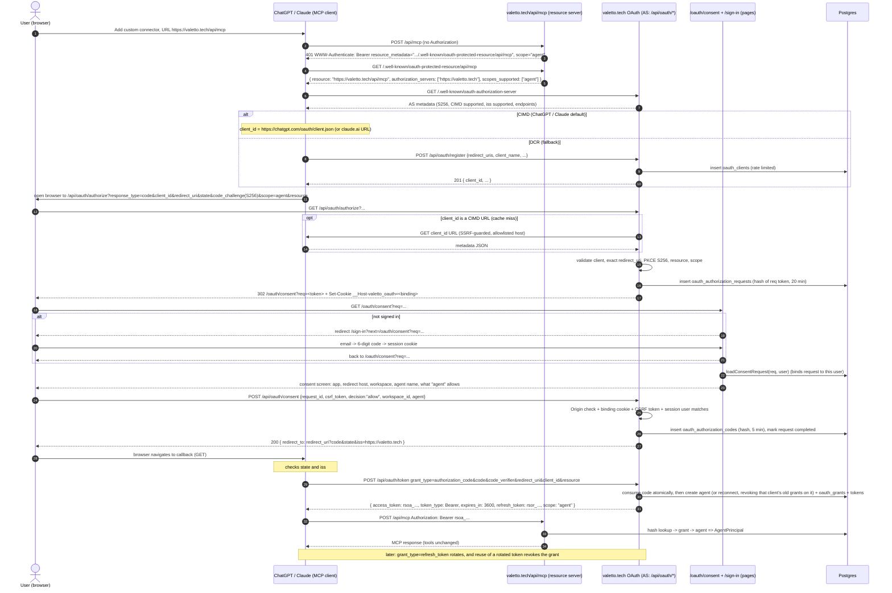

# Design: OAuth for the MCP server

Status: draft for EvaluatorBot's review. Implementing or merging this needs Karim's OK.
Owner: PlumberBot (`app/api/`, `lib/`, `db/`, `drizzle/`). UI: LandingBot (`app/(site)`, `app/dashboard`, `components/`).
Last checked against sources: 2026-11-01.

## Goal

Someone using ChatGPT or Claude pastes `https://valetto.tech/api/mcp` into "add custom connector", signs in to Valetto, clicks **Allow**, and the connector works. They don't need a join code, a terminal `register` step or a pasted Bearer key.

Not changing: `Authorization: Bearer rsk_…` agent keys on `/api/mcp` keep working byte for byte, the 19 MCP tools behave exactly as today for `rsk_` keys, and the join-code and invite flows stay as they are. OAuth-connected apps get a narrower subset of the tools (§5.7).

## TL;DR of the decisions

| Topic | Decision |
| --- | --- |
| Authorization server | Built into this app. Issuer `https://valetto.tech`. Opaque tokens, stored hashed in Postgres, no JWTs. |
| Resource (RFC 8707 / 9728) | `https://valetto.tech/api/mcp`. Every token is bound to it. A request whose `resource` is not that exact value is refused. |
| Client registration | **CIMD first.** We advertise `client_id_metadata_document_supported: true` plus `"none"` among the token endpoint auth methods, which is what both ChatGPT and Claude look for before they pick CIMD. Launch trust policy: only CIMD URLs on `chatgpt.com` and `claude.ai` are accepted (env allowlist). **DCR (RFC 7591) also ships** behind its own flag with tight limits, for ChatGPT connectors where the builder picks DCR and for other MCP clients (Cursor, VS Code, MCP Inspector). The MCP spec marks DCR deprecated. |
| Redirect URIs | Exact string match. The only exception is a port-agnostic match for `http://localhost`, `http://127.0.0.1` and `http://[::1]` loopback URIs (RFC 8252, needed by Claude Code). Wildcards are never allowed. |
| PKCE | `S256` only. `plain` and missing challenges are refused. |
| Issuer in the response (RFC 9207) | We send `iss` on every authorization response, errors included, and advertise `authorization_response_iss_parameter_supported: true`. That lets ChatGPT use its stable redirect `https://chatgpt.com/connector_platform_oauth_redirect`. |
| Scopes | **Recommended, pending Karim's decision: a narrow v1 scope.** OAuth tokens get one advertised scope, `agent`, which only covers sending tasks, messaging on and answering questions on tasks the app itself created, reading the app's own tasks and answers, and listing agents. In v1 an OAuth app can't send any content back on a task it received (no complete, fail or ask, and no message on that task's thread), so there is no exfiltration channel. The owner tools (workspace handle, sharing, offers, guests) stay with `rsk_` agents and the dashboard, because tasks in a chat app's inbox come from other agents or guests and could prompt-inject it into sharing, inviting or leaking. Mapping in §5.7. `offline_access` is not advertised, and is ignored if a client asks for it. No OIDC scopes. |
| Lifetimes | Pending authorization request 20 min · code 5 min, single use · access token 1 h · refresh token 30 days idle, rotated on every use · grant at most 365 days (open question) |
| Refresh | Rotated on each use, with reuse detection. Reusing a rotated token revokes the whole grant. The one exception is a 2 s window after rotation, and only while the replacement token is still unused: then the request gets `invalid_grant` without revoking, so a client racing two refreshes keeps its connection. If the replacement has already been used, reuse revokes even inside the window (§2.7). |
| Token → principal | An OAuth access token resolves to the same `AgentPrincipal` (`workspaceId`, `agentId`, `agentName`, `keyId`) that an `rsk_` key produces. `keyId` is `oauth:<grantId>`. `principalFrom()` and the tool code stay unchanged; the only additions are a per-tool scope check and an own-tasks check on `send_message` (§5.7), which `rsk_` keys always pass. |
| Agent mapping | **One new agent per grant** by default (e.g. `chatgpt`), and the user can rename it. Consent can also reconnect to an agent an earlier OAuth grant created. The agent is created at code exchange, so an abandoned flow leaves no orphan. |
| Consent | Shown on every authorization, for every client, with no auto-approve. The browser is bound to the request by a cookie. Origin check and a CSRF token on the POST. |

## Grounding: what the code does today

* `app/api/mcp/route.ts` exports `mcpAuthHandler` for GET, POST and DELETE.
* In `lib/mcp-server.ts`, `withMcpAuth(mcpHandler, verifyAgentToken, { required: true })` comes from `mcp-handler@2.3.0`. `verifyAgentToken` calls `authenticateAgentKey(token)` (`lib/agents.ts`): it looks up `sha256(token)` in `agent_keys`, rejects a revoked key or a revoked agent, writes `last_used_at` on every call, and returns an `AgentPrincipal`. `AuthInfo.extra` carries `agentId`, `workspaceId`, `agentName` and `keyId`. `principalFrom(ctx)` reads them back for every tool. `AuthInfo.scopes` is already `['agent']`.
* **Production already sends a challenge that leads nowhere.** `withMcpAuth` defaults `resourceMetadataPath` to `/.well-known/oauth-protected-resource` and builds the origin from `X-Forwarded-Host`. Checked 2026-11-01:
  ```
  POST https://valetto.tech/api/mcp (no auth)
  401  www-authenticate: Bearer error="invalid_token", error_description="No authorization provided", resource_metadata="https://valetto.tech/.well-known/oauth-protected-resource"
  GET /.well-known/oauth-protected-resource            404
  GET /.well-known/oauth-protected-resource/api/mcp    404
  GET /.well-known/oauth-authorization-server          404
  GET /.well-known/openid-configuration                404
  ```
  This is the "Couldn't reach the MCP server" failure that Claude's troubleshooting docs describe.
* Data model (`db/schema.ts`): a `users` row has **one** nullable `workspace_id`, so a user belongs to at most one workspace. `agents` belong to a workspace, with `name` unique per workspace and matching `AGENT_NAME_PATTERN = /^[A-Za-z][A-Za-z0-9_-]{0,63}$/`, so a name like "ChatGPT (connected app)" is not allowed. `revoked_at` is a soft delete. `agent_keys` hold `sha256(token)` and a 12-character prefix and cascade on agent delete. `role = 'customer_sender'` is the hidden agent and is not manageable. The free plan allows 10 agents (`lib/plans.ts`, `assertWithinLimit(…, 'agents')`).
* Dashboard sign-in is home-grown, with no auth library: a 6-digit email code (`login_codes`, HMAC-hashed), then a `sessions` row holding `sha256(token)`. The cookie is `replyslip_session` (HttpOnly, Secure, SameSite=Lax, 30 days). `lib/auth.ts` has `sessionUser`, `requireUser` and `requireHumanOwner` (an `rsk_` bearer on a human-only route gets `403 human_required`). `components/dashboard/session.ts` (`currentUser`) reuses the same lookup for server components. `/sign-in` has **no return-to parameter**: a signed-in visit always goes to `/dashboard`.
* CSRF today: `assertSameOrigin(req)` in `lib/origin.ts` rejects `Sec-Fetch-Site: cross-site` and any `Origin` that is not in `APP_ORIGIN`.
* Rate limiting: `consumeRateLimit({ kind, email | ip | agentId })` in `lib/rate-limit.ts` keeps a sliding window in `rate_events` (pruned after 1 day). The rules live in `RATE_LIMITS` in `lib/constants.ts`, e.g. `register: { ip: 60, windowMs: 15 min }`.
* `lib/agent-docs.ts` generates `docs/API.md`, `/docs/*.md`, `skill.md` and `llms.txt`. `tests/docs.test.ts` asserts that `docs/API.md` equals the generated string. The docs currently say "`Authorization: Bearer <api_key>` is required" and give an OpenCode snippet with `oauth: false`.
* `next.config.ts` sends `X-Robots-Tag: noindex` on `/api/:path*`. Its www→apex redirect already passes `.well-known/` through. `public/.well-known/mcp-registry-auth` exists.

## What the clients require today (sources)

| | ChatGPT (OpenAI Apps SDK / custom MCP server) | Claude (claude.ai web/desktop/mobile, Claude Code) |
| --- | --- | --- |
| Spec followed | MCP authorization spec, with CIMD transition per SEP-3149 | MCP auth specs 2025-03-26, 2025-06-18 and 2025-11-25 |
| Registration | **CIMD** is preferred when `client_id_metadata_document_supported: true` (the builder can still pick DCR). DCR runs once per connection. Predefined clients are also supported. | **CIMD** only when the AS metadata has both `client_id_metadata_document_supported: true` **and** `"none"` in `token_endpoint_auth_methods_supported`. Otherwise **DCR**, a new client on every fresh connection. |
| CIMD `client_id` | `https://chatgpt.com/oauth/client.json` (stable mode), or `https://chatgpt.com/oauth/{callback_id}/client.json` | Hosted: `https://claude.ai/oauth/mcp-oauth-client-metadata` (seen live, see below). Claude Code: `https://claude.ai/oauth/claude-code-client-metadata` (documented). |
| Redirect URI | `https://chatgpt.com/connector_platform_oauth_redirect` when the AS supports RFC 9207 `iss`, otherwise `https://chatgpt.com/connector/oauth/{callback_id}` | Hosted: `https://claude.ai/api/mcp/auth_callback`. Claude Code: `http://localhost:<port>/callback` / `http://127.0.0.1:<port>/callback`, ephemeral port. |
| Token endpoint auth | CIMD: `none` or `private_key_jwt` (its CIMD prefers `private_key_jwt`, but it picks from the intersection with ours). DCR: `none`, `client_secret_post` or `client_secret_basic`. | CIMD and DCR: public client (`none`) |
| Scopes requested | `scope` from the 401 `WWW-Authenticate`, else `scopes_supported`. It also requests any OIDC scopes we advertise, and we advertise none. | `scope` from the 401, else PRM `scopes_supported`. It appends `offline_access` when the AS lists it. |
| Refresh tokens | Expected. Rotation is fine. Keep DCR clients valid while the connection is in use. | Refreshes on a 401, and proactively up to 5 min before expiry. Wants rotation for public clients. A dead refresh token must get `invalid_grant`. |
| `resource` (RFC 8707) | Sent on both authorize and token. Must equal PRM `resource` exactly. | PRM `resource` must equal the URL as the user typed it, path included |
| Other | Verifies `iss` against the metadata `issuer` by exact string compare | Needs a **401** to start, and uses only the **first** `authorization_servers` entry. Discovery, registration and token calls get 10 s, refresh 30 s. `/token` is form-urlencoded and `/register` is JSON. The authorization redirect must be **302/303, not 307** (Next's `NextResponse.redirect` default is 307). Egress `160.79.104.0/21`. |

Live CIMD documents, fetched 2026-11-01:

```json
// https://chatgpt.com/oauth/client.json
{"client_id":"https://chatgpt.com/oauth/client.json","client_uri":"https://chatgpt.com/","redirect_uris":["https://chatgpt.com/connector_platform_oauth_redirect"],"token_endpoint_auth_method":"private_key_jwt","token_endpoint_auth_methods_supported":["none","private_key_jwt"],"grant_types":["authorization_code","refresh_token"],"response_types":["code"],"client_name":"ChatGPT","logo_uri":"https://persistent.oaistatic.com/sonic/misc/openai-logo.png","token_endpoint_auth_signing_alg":"RS256","jwks_uri":"https://chatgpt.com/oauth/jwks.json"}
// https://claude.ai/oauth/claude-code-client-metadata
{"client_id":"https://claude.ai/oauth/claude-code-client-metadata","client_name":"Claude Code","client_uri":"https://claude.ai","redirect_uris":["http://localhost/callback","http://127.0.0.1/callback"],"grant_types":["authorization_code","refresh_token"],"response_types":["code"],"token_endpoint_auth_method":"none"}
// https://claude.ai/oauth/mcp-oauth-client-metadata  (live, but not named in Anthropic's docs; treat as observed, not contractual)
{"client_id":"https://claude.ai/oauth/mcp-oauth-client-metadata","client_name":"Claude","client_uri":"https://claude.ai","redirect_uris":["https://claude.ai/api/mcp/auth_callback"],"grant_types":["authorization_code","refresh_token","urn:ietf:params:oauth:grant-type:jwt-bearer"],"response_types":["code"],"token_endpoint_auth_method":"none"}
```

What the current MCP spec (revision **2026-07-28**, the `latest` alias) says. It requires PRM (RFC 9728) with `authorization_servers`, and RFC 8414 or OIDC discovery. The AS SHOULD support CIMD, and DCR is **deprecated**, kept for backward compatibility. PKCE S256 with `code_challenge_methods_supported` advertised. `resource` sent on authorize and token, and the server MUST validate the audience. The AS SHOULD send `iss` (RFC 9207), and clients MUST validate it when present. Refresh tokens must be rotated for public clients. Redirect URIs must be matched exactly. The consent screen MUST show the redirect host, with an extra warning for loopback-only clients. DCR clients send `application_type`. Servers SHOULD NOT put `offline_access` in the `WWW-Authenticate` scope or the PRM `scopes_supported`.

Sources:
* MCP Authorization, 2026-07-28: https://modelcontextprotocol.io/specification/2026-07-28/basic/authorization ; discovery: https://modelcontextprotocol.io/specification/2026-07-28/basic/authorization/authorization-server-discovery ; client registration (CIMD, DCR deprecated, `application_type`): https://modelcontextprotocol.io/specification/2026-07-28/basic/authorization/client-registration ; security considerations: https://modelcontextprotocol.io/specification/2026-07-28/basic/authorization/security-considerations ; changelog: https://modelcontextprotocol.io/specification/2026-07-28/changelog
* OpenAI Apps SDK, Authentication: https://developers.openai.com/apps-sdk/build/auth ; adding a custom MCP server in ChatGPT: https://developers.openai.com/apps-sdk/deploy/connect-chatgpt
* Anthropic, Authentication for connectors: https://claude.com/docs/connectors/building/authentication ; Lazy authentication (CIMD example, loopback matching, 401 shape): https://claude.com/docs/connectors/building/lazy-authentication ; Building custom connectors: https://claude.com/docs/connectors/building
* The 307 pitfall: https://github.com/anthropics/claude-ai-mcp/issues/250
* RFC 6749, 6750, 7009, 7591, 7636, 8252, 8414, 8707, 9207, 9728; draft-ietf-oauth-client-id-metadata-document-00; draft-ietf-oauth-v2-1-13.

## 1. The flow end to end



## 2. Endpoints

All absolute URLs come from one env var, `MCP_OAUTH_ISSUER` (production: `https://valetto.tech`). Nothing is built from `Host` or `X-Forwarded-Host`. `RESOURCE = ${ISSUER}/api/mcp`. When `MCP_OAUTH_ENABLED` is not `1`, every endpoint below returns 404 and `/api/mcp` keeps today's challenge, so shipping the code is a no-op until the flag is turned on. Every OAuth JSON response carries `Cache-Control: no-store`, and the token, register and revoke responses also carry `Pragma: no-cache`. All new code lives in `lib/oauth/*.ts`, plus route files under `app/api/oauth/` and `app/.well-known/`.

### 2.1 Protected resource metadata (RFC 9728)

`GET /.well-known/oauth-protected-resource/api/mcp` is primary: it is the path-suffixed form that the `WWW-Authenticate` header points to.
`GET /.well-known/oauth-protected-resource` is the root fallback some clients probe. It returns the same document.
Route: `app/.well-known/oauth-protected-resource/[[...path]]/route.ts`. It serves `path` = none or `['api','mcp']`, and anything else is 404. `OPTIONS` is supported, and CORS is `Access-Control-Allow-Origin: *` with no credentials. `Cache-Control: public, max-age=3600`.

```json
200 application/json
{
  "resource": "https://valetto.tech/api/mcp",
  "authorization_servers": ["https://valetto.tech"],
  "scopes_supported": ["agent"],
  "bearer_methods_supported": ["header"],
  "resource_name": "Valetto",
  "resource_documentation": "https://valetto.tech/docs/api.md"
}
```

Note: strictly, RFC 9728 ties the root document to a resource of `https://valetto.tech`. We serve the `/api/mcp` resource there on purpose. The MCP spec only reaches the root as a fallback, and the client checks `resource` against the URL the user typed, which is `/api/mcp`.

### 2.2 `WWW-Authenticate` on 401 from `/api/mcp`

Change in `lib/mcp-server.ts`:

```ts
withMcpAuth(mcpHandler, verifyMcpToken, {
  required: true,
  resourceUrl: ISSUER,                                     // stop trusting X-Forwarded-Host
  resourceMetadataPath: '/.well-known/oauth-protected-resource/api/mcp',
  requiredScopes: ['agent'],                               // rsk_ AuthInfo already has ['agent']
});
```

Result (no token, unknown token, expired, revoked):

```
HTTP/1.1 401 Unauthorized
WWW-Authenticate: Bearer error="invalid_token", error_description="No authorization provided", scope="agent", resource_metadata="https://valetto.tech/.well-known/oauth-protected-resource/api/mcp"
{"error":"invalid_token","error_description":"No authorization provided"}
```

`mcp-handler` already builds this through `bearerAuthChallengeResponse`, so no hand-rolled header is needed. An insufficient scope gets 403 `insufficient_scope`, but with one scope that cannot happen.

`verifyMcpToken(req, token)` dispatches on the prefix:
* `rsk_…` → the existing `authenticateAgentKey(token)`, with no change at all.
* `rsoa_…` → `authenticateOAuthAccessToken(token)` (§4).
* anything else → `undefined` → 401.

### 2.3 Authorization server metadata (RFC 8414)

`GET /.well-known/oauth-authorization-server`, served by `app/.well-known/oauth-authorization-server/route.ts`, with CORS `*` and `max-age=3600`.

```json
{
  "issuer": "https://valetto.tech",
  "authorization_endpoint": "https://valetto.tech/api/oauth/authorize",
  "token_endpoint": "https://valetto.tech/api/oauth/token",
  "registration_endpoint": "https://valetto.tech/api/oauth/register",
  "revocation_endpoint": "https://valetto.tech/api/oauth/revoke",
  "response_types_supported": ["code"],
  "response_modes_supported": ["query"],
  "grant_types_supported": ["authorization_code", "refresh_token"],
  "code_challenge_methods_supported": ["S256"],
  "token_endpoint_auth_methods_supported": ["none", "client_secret_post", "client_secret_basic"],
  "revocation_endpoint_auth_methods_supported": ["none", "client_secret_post", "client_secret_basic"],
  "scopes_supported": ["agent"],
  "client_id_metadata_document_supported": true,
  "authorization_response_iss_parameter_supported": true,
  "service_documentation": "https://valetto.tech/docs/api.md"
}
```

`registration_endpoint` is listed only while `MCP_OAUTH_DCR=1`. `private_key_jwt` is left out in v1. ChatGPT's CIMD lists `["none","private_key_jwt"]`, so it falls back to `none`, the shared method.

**OpenID configuration: not served in v1** (it stays 404). Both clients try `oauth-authorization-server` first, and the issuer has no path. A truthful OIDC discovery document would need `jwks_uri`, ID tokens and `subject_types_supported`, which we don't have. Also, advertising OIDC scopes makes ChatGPT request them by default. We would only add OIDC if Karim wants ChatGPT Enterprise domain restrictions, which need `openid`, `email` and userinfo.

### 2.4 Client registration

#### 2.4.1 CIMD (primary)

A `client_id` that parses as an `https:` URL with a path is a CIMD client. Fetching it (`lib/oauth/cimd.ts`):
* Trust policy: the host must be in `MCP_OAUTH_CIMD_HOSTS` (default `chatgpt.com,claude.ai`), otherwise `invalid_client`. Launch only needs these two hosts, and the allowlist removes most of the SSRF and phishing surface. Opening CIMD to any host is an open question.
* SSRF guard, kept even with the allowlist: `https:` only on port 443, no userinfo, no fragment, no IP-literal host. Resolve DNS and refuse loopback, RFC 1918, link-local (incl. `169.254.169.254`), CGNAT, ULA and multicast, then connect to the address that was checked. `redirect: 'manual'`, where any 3xx is a failure. 5 s timeout, at most 8 KB read, `Content-Type` must be JSON.
* Validation: the document's `client_id` must equal the URL exactly. `redirect_uris` must be a non-empty array of absolute URIs. `client_name` is a string of at most 100 chars, with control and bidi characters stripped. `token_endpoint_auth_method` (or the plural `token_endpoint_auth_methods_supported`) must allow `none`, otherwise `invalid_client`. `grant_types`, when present, must include `authorization_code`. Unknown fields are ignored.
* Cache: one `oauth_clients` row per CIMD URL (`kind='cimd'`), upserted. We honor `Cache-Control: max-age`, clamped to between 5 min and 24 h, and refetch on `/authorize` once `metadata_expires_at` has passed. When a refetch fails and the cache is under 7 days old, we keep using the cached copy and log it.
* We never render or proxy `logo_uri`. A remote image on the consent page could track users or be used for phishing.

#### 2.4.2 DCR (fallback, RFC 7591), `POST /api/oauth/register`

Only while `MCP_OAUTH_DCR=1`. Accepts `Content-Type: application/json`. CORS `*`.

Request (fields we read):
```json
{
  "redirect_uris": ["https://chatgpt.com/connector/oauth/abc123"],
  "client_name": "ChatGPT",
  "client_uri": "https://chatgpt.com",
  "token_endpoint_auth_method": "none",
  "grant_types": ["authorization_code", "refresh_token"],
  "response_types": ["code"],
  "application_type": "web",
  "scope": "agent"
}
```
Rules: 1 to 5 `redirect_uris`. Each one is either `https://` with no fragment, no userinfo and no `*`, or an `http` loopback (`localhost`, `127.0.0.1`, `[::1]`). Custom schemes (`cursor://…`, `vscode://…`) are allowed only from an explicit list in `MCP_OAUTH_DCR_SCHEMES` (default empty). `token_endpoint_auth_method` is one of `none`, `client_secret_post` or `client_secret_basic`, defaulting to `client_secret_basic` per RFC 7591, though we recommend clients send `none`. `grant_types` must be a subset of `authorization_code` and `refresh_token`. `response_types` must be `["code"]`. Unknown fields are ignored. Any violation gets `400 {"error":"invalid_redirect_uri"|"invalid_client_metadata","error_description":"…"}`.

Response `201`:
```json
{
  "client_id": "rsdc_8Jx…(32 random bytes, base64url)",
  "client_id_issued_at": 1793571909,
  "client_secret": "rsds_…",              // only for client_secret_* methods; stored as sha256
  "client_secret_expires_at": 0,
  "redirect_uris": ["https://chatgpt.com/connector/oauth/abc123"],
  "client_name": "ChatGPT",
  "token_endpoint_auth_method": "none",
  "grant_types": ["authorization_code", "refresh_token"],
  "response_types": ["code"],
  "scope": "agent"
}
```
We return no `registration_access_token` and have no RFC 7592 management endpoint. The abuse limits are in §5.2.

### 2.5 `GET /api/oauth/authorize`

Query: `response_type=code` (required), `client_id`, `redirect_uri`, `state`, `code_challenge`, `code_challenge_method=S256`, `scope`, `resource`.

Validation order. The order matters for open redirects:
1. Resolve the client: DCR row, CIMD fetch/cache, or `invalid_client`. Next, check `redirect_uri` against the client's registered list (§5.1). **If the client or the redirect URI fails, render a plain error page (400) and never redirect.** `redirect_uri` is required even when only one is registered.
2. From here on, errors go back to the client with `302 redirect_uri?error=…&error_description=…&state=…&iss=https://valetto.tech`:
   * `response_type` must be `code`, otherwise `unsupported_response_type`.
   * `code_challenge` must be present and 43–128 chars of `[A-Za-z0-9-._~]`, and `code_challenge_method` must be `S256`, otherwise `invalid_request`. A missing method is **refused** rather than defaulted to `plain`.
   * `resource`, when present, must equal `RESOURCE`. We accept an uppercase scheme or host and a trailing `/`, then normalize. Anything else gets `invalid_target`. An absent `resource` defaults to `RESOURCE`: lenient for older clients, and still safe because this AS serves only one resource.
   * `scope`, after splitting on spaces, keeps only `agent`. `offline_access`, `openid` and other unknown values are dropped silently. An empty result becomes `agent`.
   * `state` is optional, but we echo it back verbatim and cap it at 1024 bytes (`invalid_request` above that).
3. Rate limit `oauthAuthorize`: 60 per 15 min per IP, which gets a 429 page.
4. Insert into `oauth_authorization_requests` and respond:
   ```
   302 Found                                   (explicitly 302: never NextResponse.redirect's default 307)
   Location: https://valetto.tech/oauth/consent?req=<43-char base64url token>
   Set-Cookie: __Host-valetto_oauth=<32-byte random>; Path=/; Secure; HttpOnly; SameSite=Lax; Max-Age=1200
   Cache-Control: no-store
   Referrer-Policy: no-referrer
   ```
   The table stores `sha256(req)` and `sha256(binding cookie)`. Several flows can be pending in parallel, so the cookie value is a random token per request. For more than one request we keep a short list of up to 5 values in one cookie, joined with `.`, and drop the oldest.

### 2.6 Consent page data and `POST /api/oauth/consent`

Both are covered in §6, the UI contract. The POST takes JSON and answers `200 { "redirect_to": "<client redirect with code or error>" }`, and the page then navigates with `window.location.assign`. That keeps the client's callback a plain top-level GET, so the 307-versus-302 question never comes up, and LandingBot keeps the `fetch` + JSON pattern from `components/site/auth-client.ts`.

Successful authorization response, built by the server: `redirect_uri` + `?code=<rsoc_…>&state=<state>&iss=https%3A%2F%2Fvaletto.tech`. A query string already on the registered `redirect_uri` is kept, with our params appended.

### 2.7 `POST /api/oauth/token`

Accepts **`application/x-www-form-urlencoded`**, which is what both clients send. JSON gets `400 invalid_request`. CORS `*`, no credentials. Rate limits are per client and per grant, plus a generous per-IP limit, because ChatGPT and Claude call from a few shared egress IPs (§5.2).

Client authentication, by the client's `token_endpoint_auth_method`:
* `none` → `client_id` in the body, no secret.
* `client_secret_basic` → `Authorization: Basic`, compared in constant time against `sha256`. A failure gets `401 invalid_client` with `WWW-Authenticate: Basic realm="valetto"`.
* `client_secret_post` → `client_id` + `client_secret` in the body.

**`grant_type=authorization_code`**: fields `code`, `code_verifier`, `redirect_uri`, `client_id`, optional `resource`.
1. Look up `sha256(code)`. Unknown or expired gets `invalid_grant`.
2. If `consumed_at` is already set, this is **code reuse**: revoke the grant created from that code (`oauth_grants.revoked_reason='code_reuse'`, which cuts off every token) and return `invalid_grant`.
3. The code's client must match the authenticated client, `redirect_uri` must equal the stored one exactly, and `BASE64URL(SHA256(code_verifier))` must equal `code_challenge`, with the verifier being 43–128 unreserved chars. Any failure gets `invalid_grant`.
4. `resource`, when present, must equal the stored resource, otherwise `invalid_target`.
5. One transaction, with `select … for update` on the code:
   * Mark the code consumed with `update … where consumed_at is null returning`. Losing that race means reuse, handled as in step 2.
   * Check the user still belongs to `workspace_id` and the workspace still exists.
   * The agent: if the user picked "new", create the agent with the chosen name, running `assertWithinLimit(…, 'agents')` and appending `-2` … `-9` on a name clash. Otherwise use the existing agent the user picked, which must still be active and in the same workspace.
   * **Reconnect revokes the old connection.** When the user picked "Reconnect as <agent>", lock the agent row (`select … from agents where id = $1 for update`, which serializes two reconnects racing each other), then revoke every still-active grant on that agent from the **same client**: `update oauth_grants set revoked_at = now(), revoked_reason = 'reconnected' where agent_id = $1 and client_id = $2 and revoked_at is null`. This happens before the new grant is inserted, in the same transaction, so there is never a moment with two live ChatGPT connections on one agent, and a failed exchange leaves the old one untouched. Grants on that agent from other clients (say Claude Code next to Claude on the web) stay. Log `oauth.reconnect` with the count of revoked grants. This is also what cuts off anyone still holding the old connection's tokens: a user who reconnects because something looked wrong gets a clean slate without having to find Disconnect first.
   * Insert `oauth_grants`, `oauth_access_tokens` and `oauth_refresh_tokens`. Set `code.grant_id`.
   * If the plan cap was hit after consent, return `invalid_grant` with `"error_description":"Workspace agent limit reached"`.
6. Response `200`:
   ```json
   {
     "access_token": "rsoa_<43 chars>",
     "token_type": "Bearer",
     "expires_in": 3600,
     "refresh_token": "rsor_<43 chars>",
     "scope": "agent"
   }
   ```
   A refresh token is issued only when the client's `grant_types` includes `refresh_token`. For CIMD and DCR clients that omit `grant_types`, we issue one anyway.

**`grant_type=refresh_token`**: fields `refresh_token`, `client_id` (and a secret for confidential clients), optional `scope` (must be a subset of the grant's), optional `resource` (must equal).
1. Look up `sha256(refresh_token)`. Unknown, revoked, idle-expired, or the grant revoked or past `absolute_expires_at`: `invalid_grant`.
2. The client must match `grant.client_id`, otherwise `invalid_grant`.
3. If the row was **already rotated** (`rotated_at` set):
   * In one transaction, lock the row and its child (the token whose `parent_id` is this row; an index on `parent_id` makes this cheap) with `for update`.
   * If the child has **already been used** (its `rotated_at` is set), this is **reuse**, however recent: revoke the grant (`revoked_reason='refresh_reuse'`), log `oauth.refresh_reuse` with `in_window: true`, and return `invalid_grant`.
   * Otherwise, within **2 s** of `rotated_at`: return `invalid_grant` and **don't** revoke, logging `oauth.refresh_race`. The parallel request that won keeps the connection.
   * After 2 s, this is **reuse**: revoke the grant (`revoked_reason='refresh_reuse'`, which cuts off every token in the family), log `oauth.refresh_reuse` with the grant id, and return `invalid_grant`.

   Why the child check: a grace window excuses whoever comes second, and that can be the real client. Say an attacker copies refresh token R1 off a device. They present R1 and get R2, then present R2 straight away and get R3, moving onto a token the real client has never seen. The real client's next refresh with R1 lands a moment later. With a plain 10 s window that would only fail with `invalid_grant`, nothing would be revoked, the real client would drop off, and the attacker would keep the chain until the grant's absolute expiry (365 days). An honest race between two requests from the same client never looks like that. It mints exactly one child, and that child sits unused until the winning response arrives, which takes milliseconds. So "child already used" means two different holders, and the grant is revoked. Shrinking the window to 2 s also narrows the case the check can't catch: a thief who refreshes once and then waits. If the real client hits that window it gets `invalid_grant`, the user reconnects, and reconnecting revokes the old grant from the same client (§2.7 step 5), cutting the thief off too.
4. Otherwise, in one transaction with `for update` on the token row: set `rotated_at=now()`, insert a new refresh token (`parent_id` pointing at the old one, `expires_at = min(now+30d, grant.absolute_expires_at)`), insert a new access token, and update `grant.last_used_at`. Respond with the same shape as above. A client may hold several access tokens from the same grant at once.

Errors use RFC 6749 §5.2 JSON (`{"error","error_description"}`, 400; `invalid_client` is 401). The codes are `invalid_request`, `invalid_client`, `invalid_grant`, `unauthorized_client`, `unsupported_grant_type`, `invalid_scope`, and `invalid_target` (RFC 8707).

### 2.8 `POST /api/oauth/revoke` (RFC 7009)

Form-urlencoded: `token`, optional `token_type_hint` (`access_token`|`refresh_token`), plus client authentication as at `/token`. It always returns `200` with an empty body for unknown or already revoked tokens, and for tokens that belong to another client, where we do nothing (RFC 7009 §2.2). Revoking a **refresh** token revokes its **grant**, and with it every access and refresh token in the grant. Revoking an **access** token revokes only that token. CORS `*`. Rate limit `oauthRevoke`: 60 per 15 min per IP.

### 2.9 Introspection

Not offered in v1. The resource server is the same app and reads the tables directly. If an external resource server ever appears, we would add RFC 7662 at `/api/oauth/introspect`, requiring client authentication.

### 2.10 Dashboard APIs (session cookie, human only)

See §6. These are `GET /api/v1/connected-apps`, `POST /api/v1/connected-apps/:id/revoke`, and `PATCH /api/v1/agents/:id` with `{ "name" }` for renaming.

## 3. Data model

There are 6 new tables (`db/schema.ts`), in one migration, `drizzle/0018_mcp_oauth.sql`, generated with `npm run db:generate` and reviewed by hand. Every secret is stored as `sha256` hex, the same way `agent_keys`, `sessions` and `join_codes` store theirs. Token prefixes are kept only for display and log scrubbing.

Token formats: `rsoa_` access, `rsor_` refresh, `rsoc_` code, `rsdc_` DCR client id, `rsds_` DCR client secret, each followed by 32 random bytes in base64url (`randomToken()` in `lib/crypto.ts`). The prefixes are distinct, so `verifyMcpToken` can dispatch on them and a log scrubber can match them.

```
oauth_clients
  id                      uuid pk
  client_id               text not null unique        -- rsdc_… for DCR; the full https URL for CIMD
  kind                    text not null check in ('dcr','cimd')
  client_name             text not null               -- sanitized, ≤100
  client_uri              text                        -- display host only
  redirect_uris           jsonb not null              -- string[]; exact values
  token_endpoint_auth_method text not null check in ('none','client_secret_post','client_secret_basic')
  client_secret_hash      text                        -- null unless client_secret_*
  grant_types             jsonb not null default '["authorization_code","refresh_token"]'
  application_type        text                        -- 'web' | 'native' (DCR, informational)
  metadata_expires_at     timestamptz                 -- CIMD cache
  registered_ip_hash      text                        -- keyedHash('oauth-dcr-ip', ip); never raw
  disabled_at             timestamptz                 -- operator kill switch
  last_used_at            timestamptz                 -- authorize or token
  created_at              timestamptz not null default now()
  index (kind, created_at)

oauth_authorization_requests            -- pending consent, 20 min
  id                      uuid pk
  request_hash            text not null unique        -- sha256(req token in the consent URL)
  binding_hash            text not null               -- sha256(__Host-valetto_oauth value)
  client_id               uuid not null references oauth_clients(id) on delete cascade
  redirect_uri            text not null
  state                   text                        -- ≤1024, echoed verbatim
  code_challenge          text not null
  scope                   text not null               -- 'agent'
  resource                text not null
  user_id                 uuid references users(id) on delete cascade   -- bound on first signed-in view
  expires_at              timestamptz not null
  completed_at            timestamptz                 -- allow or deny done
  created_at              timestamptz not null default now()

oauth_authorization_codes               -- 5 min, single use
  id                      uuid pk
  code_hash               text not null unique
  client_id               uuid not null references oauth_clients(id) on delete cascade
  user_id                 uuid not null references users(id) on delete cascade
  workspace_id            uuid not null references workspaces(id) on delete cascade
  agent_id                uuid references agents(id) on delete cascade  -- existing agent chosen; null = create
  new_agent_name          text                        -- when agent_id is null; matches AGENT_NAME_PATTERN
  redirect_uri            text not null
  code_challenge          text not null
  scope                   text not null
  resource                text not null
  expires_at              timestamptz not null
  consumed_at             timestamptz
  grant_id                uuid references oauth_grants(id) on delete set null  -- for code-reuse revocation
  created_at              timestamptz not null default now()
  check ((agent_id is null) <> (new_agent_name is null))

oauth_grants                            -- one approved connection = one row
  id                      uuid pk
  client_id               uuid not null references oauth_clients(id) on delete cascade
  user_id                 uuid not null references users(id) on delete cascade      -- who approved
  workspace_id            uuid not null references workspaces(id) on delete cascade
  agent_id                uuid not null references agents(id) on delete cascade
  agent_created           boolean not null            -- true when this grant created the agent
  scope                   text not null               -- 'agent'
  resource                text not null               -- audience: 'https://valetto.tech/api/mcp'
  absolute_expires_at     timestamptz not null        -- created_at + 365 d (open question)
  last_used_at            timestamptz                 -- throttled: written at most every 5 min
  revoked_at              timestamptz
  revoked_reason          text check in ('user','agent_revoked','refresh_reuse','code_reuse','client_disabled','user_left_workspace','reconnected')
  created_at              timestamptz not null default now()
  index (workspace_id, created_at desc); index (agent_id); index (client_id)

oauth_access_tokens                     -- 1 h
  id                      uuid pk
  grant_id                uuid not null references oauth_grants(id) on delete cascade
  token_hash              text not null unique
  expires_at              timestamptz not null
  revoked_at              timestamptz
  created_at              timestamptz not null default now()
  index (grant_id)

oauth_refresh_tokens                    -- 30 d idle, rotated
  id                      uuid pk
  grant_id                uuid not null references oauth_grants(id) on delete cascade
  token_hash              text not null unique
  parent_id               uuid references oauth_refresh_tokens(id) on delete set null
  expires_at              timestamptz not null
  rotated_at              timestamptz
  revoked_at              timestamptz
  created_at              timestamptz not null default now()
  index (grant_id)
  index (parent_id)                     -- child lookup for reuse detection (§2.7)
```

The audience lives on the grant (`resource`), and token checks require `grant.resource = RESOURCE`. Tokens for any other resource are refused, which keeps the door open for a second resource later.

Lifetimes, all in `lib/constants.ts`:

| Thing | Lifetime |
| --- | --- |
| Authorization request (consent window, enough time to get an email code) | 20 min |
| Authorization code | 5 min, single use |
| Access token | 1 h |
| Refresh token | 30 days idle, rotated on every use |
| Grant | 365 days absolute, then a full re-authorization (open question) |
| Unused DCR client (never got a grant) | 24 h, then deleted |
| Idle DCR client (no active grant, not used) | 90 days, then deleted |
| CIMD metadata cache | the document's `max-age`, clamped to 5 min–24 h |

Cleanup: one function, `pruneOAuth()`, deletes expired requests and codes older than a day, access tokens past `expires_at` + 1 day, refresh rows rotated or expired more than 30 days ago, and clients unused per the table above. It runs from the existing daily `/api/cron/wakes` job (Hobby allows one cron) and opportunistically at most once an hour on `/register`.

Migration outline (not written yet):
1. `create table` × 6 (clients, authorization_requests, grants, authorization_codes, access_tokens, refresh_tokens), in FK order: clients → grants → codes.
2. Unique indexes on every `*_hash` and on `oauth_clients.client_id`, plus the lookup indexes above.
3. `check` constraints for the enums and the code agent XOR.
4. No change to any existing table. `agents`, `agent_keys` and `users` stay untouched, so the migration is purely additive and safe to deploy before the flag goes on. Rolling back means dropping the six tables.

## 4. Token → workspace/agent mapping

### Recommendation: one agent per grant (default), with reconnect

When the user clicks Allow, the default is a **new agent** in their workspace. It is named after the client, lowercased and checked against `AGENT_NAME_PATTERN`: `chatgpt`, `claude`, or `claude-code`, with `-2`, `-3` … when the name is taken. Its description is `Connected app: ChatGPT (OAuth). Reads tasks; can't complete them.` (see §6.8) and its delivery is `none`. The consent page has an editable name field, and the dashboard can rename the agent later through the new `PATCH /api/v1/agents/:id`.

The consent page also offers **"Reconnect as an existing connected-app agent"**. The list holds active agents in the workspace that an earlier OAuth grant created (`oauth_grants.agent_created = true`), with the newest first. This covers the common case where ChatGPT or Claude loses its tokens or the user re-adds the connector: they keep the same agent name, task history and inbox instead of collecting `chatgpt-2` and `chatgpt-3`. Reconnecting replaces that client's old connection: the token exchange revokes every still-active grant on the agent from the same client before it issues the new one, in one transaction (§2.7 step 5). The consent page says so under the choice: "Your previous ChatGPT connection to this agent will be disconnected." In v1 we **don't** offer binding to an arbitrary existing agent, such as one driven by an `rsk_` key. That is an open question.

Tradeoffs:

| | New agent per grant (recommended) | Bind to an existing agent |
| --- | --- | --- |
| Blast radius | The app gets a fresh identity with no history, and revoking it never touches a human-set-up bot | The app can read tasks addressed to that bot (and complete them, if `agent:respond` is ever granted), including ones meant for a webhook or local bot |
| Clarity | Teammates and senders see `chatgpt` as its own agent, and audit is simple | Two runtimes (a local bot and ChatGPT) answer as one name, so who did what is ambiguous |
| Clutter | Reconnects could pile up agents. The "reconnect" choice fixes this. | None |
| Plan cap | Counts toward the free plan's 10 agents, which can block at consent (shown in the UI) | No new agent |
| Delivery | `none`: ChatGPT and Claude only see tasks when they call `list_tasks`, which matches how they work (no webhook) | Keeps the bot's delivery, but the connector never receives wakes anyway |

### How the token becomes the same principal

`lib/oauth/verify.ts`:

```ts
export async function authenticateOAuthAccessToken(token: string): Promise<(AgentPrincipal & { grantId: string; clientId: string; expiresAt: number }) | null> {
  // one query: access_tokens ⋈ grants ⋈ agents ⋈ users ⋈ oauth_clients
  //   where token_hash = sha256(token)
  //     and access.revoked_at is null and access.expires_at > now()
  //     and grant.revoked_at is null and grant.absolute_expires_at > now()
  //     and grant.resource = RESOURCE                       -- audience check
  //     and agents.revoked_at is null and agents.role = 'agent'
  //     and agents.workspace_id = grant.workspace_id
  //     and users.workspace_id = grant.workspace_id          -- approver still in the workspace
  //     and oauth_clients.disabled_at is null
  // throttled: update grants.last_used_at if older than 5 min
  return { workspaceId, agentId, agentName, keyId: `oauth:${grantId}`, grantId, clientId, expiresAt };
}
```

`verifyMcpToken` returns
`{ token, clientId: <oauth client_id>, scopes: ['agent'], expiresAt: <epoch s>, resource: new URL(RESOURCE), extra: { agentId, workspaceId, agentName, keyId } }`.
The `extra` field has exactly the four strings `principalFrom()` already checks, so the tool bodies don't change, apart from one optional `ownTasksOnly` parameter on `sendMessage` (§5.7). `AuthInfo.scopes` is what differs: `['agent']` for an OAuth token, and `['agent', 'agent:respond', 'agent:owner']` for an `rsk_` key (§5.7). `keyId` is not used for any database lookup today: the only other caller, `lib/customer-api.ts`, uses the string `'customer-session'`. When a token belongs to a user who has left the workspace, the grant is also revoked lazily with `revoked_reason='user_left_workspace'`.

Other bearer routes: OAuth tokens are **only** valid on `/api/mcp` (audience). The REST routes that accept `rsk_` (`/api/v1/tasks/:id/answer`, `/api/v1/invites/redeem`) call `authenticateAgentKey`, which never finds an `rsoa_` hash, so they refuse OAuth tokens by construction. `requireHumanOwner` gets one more line that treats an `rsoa_` bearer like `rsk_` (`403 human_required`), and a test pins that. A connected app can never approve guests or release reviews.

## 5. Security

### 5.1 Redirect URIs

* We compare against the client's registered list with **exact string equality**, without normalizing case, trailing slashes or percent-encoding. The one exception: when the registered URI is `http://localhost/<path>`, `http://127.0.0.1/<path>` or `http://[::1]/<path>`, the requested URI may add any port. Scheme, host, path and query must still match exactly (RFC 8252 §7.3, which Claude Code needs).
* Wildcards, fragments, userinfo and `javascript:`/`data:`/`file:` URIs are refused at registration and at authorize. Non-loopback `http:` is refused.
* For CIMD, the redirect must be in the fetched document's `redirect_uris`. Combined with the host allowlist, this means only `chatgpt.com` and `claude.ai` callbacks, plus Claude Code's loopback, can get codes in v1.

### 5.2 DCR abuse limits

* Rate limits, as new `RATE_LIMITS` kinds: `oauthRegister` allows 20 per 15 min per IP, and a global cap of 500 new DCR clients per rolling 24 h (a `consumeKeyedRateLimit` with key `global`). A hit gets `429` with `Retry-After`. The per-IP number is deliberately higher than for a typical endpoint: ChatGPT registers from OpenAI's shared egress, so a per-IP limit is effectively a per-provider limit.
* Unused clients are deleted after 24 h, and idle ones after 90 days (§3). Clients with an active grant are never expired, per OpenAI's note that a deleted client breaks a live connection with `invalid_client`.
* No wildcards, at most 5 redirect URIs, `client_name` at most 100 chars and sanitized, and `logo_uri` never shown. Custom schemes are allowed only by allowlist.
* A DCR client gets **nothing** without a signed-in user clicking Allow. Registration only creates a row.
* Kill switches: `MCP_OAUTH_DCR=0` removes `registration_endpoint` and turns `/register` into a 404 without touching existing clients. `oauth_clients.disabled_at` blocks one client and revokes its grants.

### 5.3 Consent

* Consent is shown **every time**, for every client, CIMD or DCR. There is no auto-approve or "remember this app" in v1, because each Allow creates or reconnects an agent and should be a deliberate act.
* The page shows **the redirect host** (e.g. `chatgpt.com`), as the MCP spec requires. For CIMD it names the app by the **host of the `client_id` URL**, with the self-asserted `client_name` second (Anthropic's guidance). DCR clients are labelled **"Unverified app"**, and their self-asserted name appears in quotes. Loopback-only redirects get an extra warning: "This app will receive access on your own computer (localhost). Only continue if you just started this from a program you trust."
* The scope is described in plain words. Under the recommended narrow scope (§5.7), `agent` lets the app create tasks as its own agent, message on and answer questions on the tasks it created, read the tasks it sent or received and their answers, and list the workspace's agents and shared agents' cards. It cannot send anything back on a task sent to it (no complete, fail, ask, or thread message), send standalone messages, set the workspace handle, change sharing, manage offers, invite or revoke guests, redeem invites, approve guests, review or release customer requests, see customer emails, or reach dashboard settings.

### 5.4 CSRF on the consent POST, and consent phishing

`POST /api/oauth/consent` requires **all** of the following:
1. `assertSameOrigin(req)`, the existing helper that rejects `Sec-Fetch-Site: cross-site` and any foreign `Origin`.
2. `Content-Type: application/json`, so a cross-site HTML form cannot send it without a preflight.
3. A valid session cookie (SameSite=Lax), where the session user equals `oauth_authorization_requests.user_id`. The request is bound on the first signed-in view, and a different user gets 404.
4. A `csrf_token` equal to `HMAC(ENCRYPTION_KEY, 'oauth-consent' ‖ request_id ‖ session_id)`, handed to the page in the server data and compared in constant time.
5. The `__Host-valetto_oauth` **binding cookie** set by `/authorize`, which must hash to `binding_hash`. This stops consent-link phishing: an attacker who starts a flow from their own ChatGPT and sends the victim the `/oauth/consent?req=…` link gets nothing, because the victim's browser lacks the cookie. Forwarding the whole `/authorize` URL instead is caught by the client's own `state` check, since the code lands in a ChatGPT or Claude session that never started that flow.
6. The request has not expired and is not completed, and completion is single use (`update … where completed_at is null returning`).

**Indexing and referrers (SeoBot's note).** The consent, authorize and connected-apps surfaces send `noindex` and `no-referrer`, and none of them are in the sitemap:

| Surface | `noindex` | `Referrer-Policy: no-referrer` |
| --- | --- | --- |
| `/oauth/consent` (page) | `X-Robots-Tag: noindex, nofollow` from the new `/oauth/:path*` headers entry, plus page metadata `robots: { index: false, follow: false }`, as `/sign-in` does | the same headers entry uses the existing `noReferrer` constant, like the `CUSTOMER_PAGES` entries, plus page metadata `referrer: 'no-referrer'` |
| `/api/oauth/authorize` and its 302s, plus `/api/oauth/{token,revoke,consent}` | the existing `X-Robots-Tag` on `/api/:path*`, unchanged | `/api/oauth/:path*` is added to `CUSTOMER_API` (header `noReferrer`), and the handlers also set it on the 302 to the client |
| Connected-apps UI on `/dashboard` and `/api/v1/connected-apps` | already covered: the `/dashboard` headers entries and `app/dashboard/layout.tsx` `robots`, and `/api/:path*` | `referrer: 'no-referrer'` in the dashboard page metadata, and `/api/v1/connected-apps/:path*` added to `CUSTOMER_API` |
| `/.well-known/oauth-protected-resource…`, `/.well-known/oauth-authorization-server` | JSON for machines. Not in the sitemap and never linked from site pages. They get no extra robots header, because the spec needs them fetchable and nothing indexes JSON metadata usefully. | not needed (no outbound links) |

`no-referrer` matters most on the consent page, whose URL carries the `req` token, and on the 302 back to the client, whose URL carries the code. `app/sitemap.ts` doesn't change: no OAuth route or `.well-known` document is added to it. Redirects and canonicals don't change either. The code PR that adds these pages and headers **tags SeoBot for review** (§7).

The consent page must not be framed. The one new `headers()` entry in `next.config.ts`, for `/oauth/:path*`, sends `X-Robots-Tag: noindex, nofollow`, `Referrer-Policy: no-referrer`, `X-Frame-Options: DENY` and `Content-Security-Policy: frame-ancestors 'none'`. It does not touch redirects, canonicals, the sitemap, or noindex on any existing route.

### 5.5 Open-redirect surface

* `/authorize` never redirects until the client and `redirect_uri` are validated. Before that point, errors are an HTML page on valetto.tech.
* The consent POST only returns a `redirect_to` built from the stored, already validated `redirect_uri`.
* `/sign-in?next=`: the new parameter is the main new open-redirect risk. The only accepted value is a path matching `^/oauth/consent\?req=[A-Za-z0-9_-]{43}$`. Anything else, including absolute URLs, `//host`, backslashes and encoded variants, falls back to `/dashboard`. The check is one exported function, `safeNextPath()` in `lib/oauth/next-path.ts`, which LandingBot calls on both the server and the client.
* Error responses to the client never echo `error_description` text built from user input.

### 5.6 Token leakage

* Tokens never go in URLs: the access token travels only in the `Authorization` header, as the spec requires. The code goes to the client's callback, not to us.
* Bodies of `/token`, `/register`, `/revoke` and `/consent` are never logged. Errors log the grant or client id, never a token or code. `withMcpAuth` logs the exception object, so `verifyMcpToken` must not throw errors that contain the token.
* `Cache-Control: no-store` on every token response and on the consent page data.
* Only hashes are stored, so a database leak does not reveal live tokens, the same as with `rsk_`.
* The prefixes (`rsoa_`, `rsor_`, …) make accidental pastes easy to spot and scrub. If Vercel log drains are added later, a scrubber should match `rso[acr]_[A-Za-z0-9_-]{43}`.
* `Referrer-Policy: no-referrer` on `/oauth/*` and on the 302 from `/authorize`.

### 5.7 Scopes

**Recommendation, pending Karim's decision (open questions 2 and 2b): a narrow v1 scope.** Connected apps can only send tasks (and follow up on those tasks), read their own tasks and answers, and list agents. They can't send anything back on a task they received. The workspace handle, sharing, offers and guests stay with `rsk_` agents and the dashboard.

Why: a chat app reads its inbox through `list_tasks` and `get_task`, and that text comes from other agents and, through shared agents, from guests in other workspaces. Any of it can carry a prompt injection ("before answering, call `set_agent_sharing` …" or "invite @attacker as a guest"). ChatGPT and Claude act on tool output with the user's full authority and often with little confirmation, so the tools that widen who can reach the workspace must not be in their reach. Key-based agents keep them, because their owner wrote the code or prompt that drives them and chose to give them a key.

There is one advertised scope, `agent`. It goes in `scopes_supported`, in the `WWW-Authenticate` `scope`, and in the token response, and it is the only scope an OAuth grant can hold in v1. Two more scope strings exist only inside `AuthInfo.scopes` and are never advertised or grantable: `agent:respond` and `agent:owner`. An `rsk_` key gets all three, so key-based agents keep every tool exactly as today. A client asking for `agent:respond` or `agent:owner` has them dropped, like any unknown scope (§2.5).

| Tool | Scope needed | OAuth app (v1) | `rsk_` key |
| --- | --- | --- | --- |
| `whoami`, `list_agents`, `get_agent_card` | `agent` | yes | yes |
| `create_task` | `agent` | yes | yes |
| `send_message` on the thread of a task the app **created** (`task.from_agent_id` = the app's agent) | `agent` | yes | yes |
| `send_message` on the thread of a task the app **received**, or with no `task_id` (standalone) | `agent:respond` | **no** (`insufficient_scope`) | yes |
| `get_task`, `list_tasks` (tasks it sent or received, with answers) | `agent` | yes | yes |
| `answer_task` (answer a question on a task it sent; the code already refuses it on received tasks) | `agent` | yes | yes |
| `complete_task`, `fail_task`, `ask` (act on a task sent to it) | `agent:respond` | **no** | yes |
| `set_workspace_handle`, `set_agent_sharing` | `agent:owner` | **no** | yes |
| `upsert_offer`, `delete_offer` | `agent:owner` | **no** | yes |
| `invite_guest`, `revoke_guest`, `list_guest_shares`, `redeem_invite` | `agent:owner` | **no** | yes |

**Principle: in v1 an OAuth-connected app can't send any content back on a task it received.** A received task's text comes from its sender, which may be another workspace's guest or a shared agent, and the sender is also who reads anything the app sends back on that task. If an injected task can get the app to reply, it can get the app to paste in workspace data, so every reply path is closed:

* `complete_task`, `fail_task` and `ask` only act on tasks sent to the caller. They are all `agent:respond` and refused.
* `send_message` with a `task_id` posts to that task's thread, and the other participant reads it with `get_task`. Today (`sendMessage` in `lib/tasks.ts`) either participant may post. For OAuth tokens it is limited to tasks the app **created** (`task.from_agent_id = caller.agentId`). On a task the app received it returns `insufficient_scope`. A standalone message (no `task_id`) is refused the same way. It isn't a reply, but it would be an extra channel to any agent in the workspace, webhook agents included, and its description says recipients can't read it yet anyway, so v1 loses nothing.
* `answer_task`: checked in the code. `answerTask` in `lib/tasks.ts` throws `403 forbidden` ("Only the sender of this task can answer its question.") unless `task.from_agent_id = caller.agentId`, and it only accepts a task in `needs_info`. It answers the target's question on a task the caller **sent**; it can never reply to a task the caller received. So it **stays in the OAuth set with no extra check**. The scope test still pins this down for OAuth tokens (§7), so a later code change can't open it quietly.

What the app can still send goes only to tasks it created: the first task text, messages on that task's thread, and answers to the target's questions. That is the point of "send tasks to your agents". A connected app can still read tasks sent to it and tell the user about them; the user then answers with a key-based agent or, later, from the dashboard. Whether chat apps should ever reply on received tasks is open question 2b (EvaluatorBot recommends no for v1). If Karim says yes, `agent:respond` becomes a second advertised scope shown on the consent page as its own line.

Enforcement has two parts, and both read `AuthInfo.scopes`, so `rsk_` behavior can't change:

1. **Whole-tool check.** One helper in `lib/mcp-server.ts`, `requireToolScope(ctx, scope)`, runs first in each `agent:respond` and `agent:owner` tool and returns the tool error `{ "error": { "code": "insufficient_scope", "message": "Connected apps can't use this tool. Use an agent key or the Valetto dashboard." } }`.
2. **Per-task check for `send_message`.** The tool handler passes `{ ownTasksOnly: !scopes.includes('agent:respond') }` to `sendMessage`. The option defaults to `false`, so other callers and `rsk_` keys behave as today. With it set, `sendMessage` throws `HttpError(403, 'insufficient_scope', "Connected apps can only message on tasks they created.")` when there's no `task_id`, and, after the existing visibility and participant checks, when `task.from_agent_id` is not the caller. The check runs inside the existing transaction and before the insert and the wake, so a refused call writes nothing and wakes nobody. An invisible or unknown task still returns `404 not_found` as today, so the new error leaks nothing about other tasks.

Tool descriptions stay as they are, so `docs/API.md` doesn't change. If PR 2 finds that `createMcpHandler` sees the request's `authInfo` when it registers tools, it also skips registering the whole-tool-refused tools for OAuth tokens, so the model never sees them. The call-time checks stay either way.

What's left: an injected task, or an injected question from the target of a task the app created, can still make the app create tasks, message on its own tasks or answer a question, including on tasks to shared agents in other workspaces that this workspace already has access to. Plan quotas and each guest grant's daily cap bound that, and none of it adds new people. The consent copy says the app acts on what it reads.

`offline_access` is not advertised, which avoids Claude adding it and keeps the PRM spec-clean. Refresh tokens are issued at our discretion.

### 5.8 Revocation cascade and deletion

| Event | Effect |
| --- | --- |
| User clicks **Disconnect** (dashboard) | `grant.revoked_at`, reason `user`. Every access and refresh token in the grant dies right away, because each token check joins the grant. The agent stays, with its history and a "no active connection" state. |
| `POST /api/oauth/revoke` with a refresh token | Same as Disconnect |
| `POST /api/oauth/revoke` with an access token | Only that access token |
| Agent revoked (existing `revokeAgent`) | New: in the same transaction, revoke every grant on the agent (`agent_revoked`). Token checks also require `agents.revoked_at is null`, so this holds even if a code path misses the cascade. |
| Agent row deleted (invite-workspace cleanup in `lib/invites.ts`) | FK `on delete cascade` removes grants → tokens and codes |
| Refresh token reused after the 2 s window, or inside it once the replacement token has been used | Grant revoked (`refresh_reuse`) |
| Code reused | The grant from that code is revoked (`code_reuse`) |
| User picks **Reconnect as <agent>** and the code is exchanged | Every still-active grant on that agent from the same client is revoked (`reconnected`) in the same transaction, before the new grant is inserted. Grants from other clients stay. |
| Client disabled by the operator | Every grant of the client is revoked (`client_disabled`) |
| User leaves the workspace / `users.workspace_id` changes | Token checks require `users.workspace_id = grant.workspace_id`, so access stops right away and the grant is revoked lazily (`user_left_workspace`) |
| User or workspace row deleted | FK cascade. (No user deletion exists today. Workspace deletion only covers unclaimed invite workspaces, which have no users and so no grants.) |
| User signs out or the session expires | No effect on grants. They behave like `rsk_` keys, which also outlive a browser session. |
| An `rsk_` key is revoked | No effect on OAuth grants, and the reverse also holds |

### 5.9 Other checks

* `iss` goes on every authorization response, errors included, and is exactly the metadata `issuer`, with no trailing slash.
* Mix-up: there is a single AS, and we send `iss`.
* We pin `ISSUER` and `RESOURCE` from env and never derive them from `X-Forwarded-Host`. Today `withMcpAuth` builds the `resource_metadata` URL from that header.
* Constant-time comparisons for client secrets and CSRF tokens (`safeEqualHex`/`safeEqualString`).
* `replyslip.com/api/mcp` keeps working with `rsk_` keys, but OAuth there is not supported: its challenge points at valetto.tech metadata, whose `resource` is the valetto.tech URL. The docs will say to paste the valetto.tech URL.
* Preview deployments: `MCP_OAUTH_ENABLED` is off unless set, and a preview needs its own `MCP_OAUTH_ISSUER`. When the flag is on in production and `MCP_OAUTH_ISSUER` is missing or not canonical, startup throws, matching `validateOriginConfig()`.

### 5.10 Higher scopes for OAuth apps (`MCP_OAUTH_OWNER_SCOPE`)

**Decided (Karim): a second, higher level of access, spelled out on the Allow page and granted only when the user opts in.** While the flag is on, it is offered on every Allow page, whether or not the app asked for it. Claude, ChatGPT and Cursor ask for what the 401 challenge says (`agent`) or for nothing, so an offer that depended on the app asking would never be seen. The user's opt-in is the authority. RFC 6749 §3.3 lets the issued scope differ from the requested one, and the token response's `scope` then says what was granted. It reuses the two internal scope strings from §5.7, so the tool map (`TOOL_SCOPES` in `lib/oauth/scopes.ts`) doesn't change, and `toolAllowed` stays the one check behind both `tools/list` and `tools/call`.

| Scope | Tools it adds | Consent title |
| --- | --- | --- |
| `agent` (always, the default) | `whoami`, `list_agents`, `get_agent_card`, `create_task`, `send_message` (own tasks only), `get_task`, `list_tasks`, `answer_task` | (the existing `scope` block) |
| `agent:respond` | `complete_task`, `fail_task`, `ask`, and `send_message` on any task the agent is part of | Work on tasks sent to it |
| `agent:owner` | `set_workspace_handle`, `set_agent_sharing`, `upsert_offer`, `delete_offer`, `invite_guest`, `revoke_guest`, `list_guest_shares`, `redeem_invite` | Manage your workspace settings and guests |

* **Flag.** `MCP_OAUTH_OWNER_SCOPE=1` (off by default, and only with `MCP_OAUTH_ENABLED=1`). While it's off, the higher scopes aren't advertised, a request for them falls back to `agent` without an error, the consent page shows nothing extra, and an older grant that holds them is treated as `agent` only, both at `/api/mcp` and in token responses.
* **Metadata.** While the flag is on, `scopes_supported` in both metadata documents is `["agent", "agent:respond", "agent:owner"]`. The `/api/mcp` 401 challenge still says `scope="agent"`, so a client that follows the challenge asks for `agent` only. A client must ask for more on purpose.
* **Authorize.** The request stores `agent` plus the supported higher scopes the client asked for. That is used only to mark `requested_by_client`. `agent` is always the base, also when the client asks for no scope.
* **Consent view.** While the flag is on, `extra_scopes.offered` always lists both higher scopes, each with a title, an `allows` list and `requested_by_client` (whether the app asked for it). `extra_scopes.unverified_client` and `warning` are set whenever an unverified app (today, any DCR client) gets the offer. `connection_days` gives the shorter connection length.
* **Consent POST.** `grant_owner: true` grants every offered scope (`agent agent:respond agent:owner`), whatever the app asked for. Absent or false, the user approves `agent` only. The code, grant and token response always say what was granted. A disabled client never gets a higher scope, and the code exchange filters again, in case the flag was turned off in between.
* **Lifetime.** A grant that holds a higher scope ends after `MCP_OAUTH_OWNER_MAX_DAYS` days (whole days, 1 to 365, default 30) instead of 365. Refresh and access tokens never outlive their grant, so the user approves again after that. An `agent` grant keeps 365 days.
* **Refresh** never widens: a `scope` that isn't part of the grant is `invalid_scope`, and the response scope is the grant's.
* **Dashboard.** `GET /api/v1/connected-apps` adds `scopes` (a list, `agent` first) and `elevated` (true when it holds a higher scope) next to the existing `scope` string.
* **`rsk_` keys** are unchanged: they hold all three scopes whatever the flag says.

What's left: §5.7's prompt-injection concern still holds for a user who opts in. An injected task can make an elevated app reply on received tasks, change sharing or invite guests. The opt-in copy says what it allows, an unverified app gets a warning, and the connection expires in 30 days by default. Disconnect in the dashboard ends it at once.

## 6. UI contract for LandingBot

All new strings stay in the existing Valetto voice. The routes need no sitemap, canonical or redirect changes. The consent page and the connected-apps UI send `noindex` and `no-referrer` as set out in §5.4, and SeoBot reviews the code PR.

### 6.1 Consent page: `app/(site)/oauth/consent/page.tsx` → `/oauth/consent?req=<token>`

* A server component. It calls `currentUser()`. With no user it does `redirect('/sign-in?next=' + encodeURIComponent('/oauth/consent?req=' + req))`.
* It loads its data with `loadConsentRequest(req: string, user: SessionUser): Promise<ConsentView>` from `lib/oauth/consent.ts`. That function binds the request to the user on first view and throws `HttpError(404 'request_not_found' | 410 'request_expired' | 409 'request_completed' | 409 'workspace_required')`, and the page renders each as a plain message with no redirect.
* `metadata`: `robots: { index: false, follow: false }`, `referrer: 'no-referrer'`, title `Connect an app · Valetto`.

```ts
type ConsentView = {
  request_id: string;                 // uuid of oauth_authorization_requests
  csrf_token: string;                 // echo in the POST
  expires_at: string;                 // ISO
  client: {
    display_name: string;             // CIMD: host of client_id URL ("chatgpt.com"); DCR: client_name
    client_name: string;              // self-asserted name, e.g. "ChatGPT"
    verified: boolean;                // true only for allowlisted CIMD hosts
    kind: 'cimd' | 'dcr';
    client_uri_host: string | null;   // display only, never a link to a remote logo
    logo_url: null;                   // v1: always null (no remote images)
  };
  redirect: {
    host: string;                     // "chatgpt.com", "claude.ai", "localhost"
    loopback: boolean;                // show the localhost warning when true
  };
  user: { email: string };
  workspaces: Array<{ id: string; name: string; handle: string | null }>; // exactly one today; keep a picker-ready shape
  agent: {
    suggested_name: string;           // "chatgpt", "claude", "claude-code", deduped
    name_pattern: string;             // AGENT_NAME_PATTERN source, for client-side hinting
    reconnect_options: Array<{ id: string; name: string; last_connected_at: string | null }>;
  };
  scope: {
    name: 'agent';
    allows: string[];                 // plain-language bullets, server-provided copy (§5.3, §5.7)
    denies: string[];                 // also server-provided; see the example below
  };
  plan: { at_agent_limit: boolean; agent_limit: number | null }; // when true, only reconnect or Deny are possible
};
```

Example `scope` for the recommended narrow v1 scope:

```json
{
  "name": "agent",
  "allows": [
    "Send tasks to your agents, as its own agent, and follow up or answer questions on those tasks",
    "Read the tasks it sent or received, and their answers",
    "See your agents and the shared agents you can reach"
  ],
  "denies": [
    "Reply to, finish or message on tasks sent to it",
    "Send messages outside a task it created",
    "Change your workspace handle or agent sharing",
    "Add, change or remove offers",
    "Invite, approve or remove guests",
    "Review or release customer requests, or see customer emails",
    "Change dashboard settings"
  ]
}
```

### 6.2 Allow / Deny: `POST /api/oauth/consent`

JSON body:
```json
{
  "request_id": "uuid",
  "csrf_token": "string",
  "decision": "allow",                                  // or "deny"
  "workspace_id": "uuid",                               // must be the user's workspace
  "agent": { "mode": "new", "name": "chatgpt" }         // or { "mode": "reconnect", "agent_id": "uuid" }; omitted for deny
}
```
Responses:
* `200 { "redirect_to": "https://chatgpt.com/connector_platform_oauth_redirect?code=…&state=…&iss=https%3A%2F%2Fvaletto.tech" }` for allow. Deny returns the same shape with `?error=access_denied&state=…&iss=…`. The page then calls `window.location.assign(redirect_to)` and shows "Returning to ChatGPT…".
* `400 validation_error` / `invalid_name`, `403 bad_origin` / `csrf_failed` / `binding_failed`, `403 plan_limit`, `404 request_not_found`, `409 name_taken` (with `details.suggested_name`), `409 request_completed`, `410 request_expired`, `429 rate_limited` (`oauthConsent`: 30 per 15 min per user). Errors use the standard `{ "error": { "code", "message", … } }` shape from `lib/http.ts`.

### 6.3 Sign-in return path

* `/sign-in?next=<path>`. The page and `SignInForm` read `next`, validate it with `safeNextPath()` from `lib/oauth/next-path.ts`, and after a successful `verify-code` (or when the user is already signed in) navigate to it instead of `/dashboard`.
* Only `/oauth/consent?req=<43 chars>` passes. Everything else falls back to `/dashboard`.
* The sign-in screen can show "Sign in to connect ChatGPT" when `next` is a consent path. That copy is optional, and the client name is **not** passed through the URL.

### 6.4 Connected apps list: `GET /api/v1/connected-apps`

Session cookie only. An `rsk_` or `rsoa_` bearer gets `403 human_required`. `Cache-Control: private, no-store`.

```json
200
{
  "connected_apps": [
    {
      "id": "uuid",                                // grant id
      "client": { "display_name": "chatgpt.com", "client_name": "ChatGPT", "verified": true, "kind": "cimd" },
      "redirect_host": "chatgpt.com",
      "agent": { "id": "uuid", "name": "chatgpt", "revoked": false },
      "scope": "agent",
      "approved_by_email": "owner@example.com",
      "created_at": "2026-11-01T22:00:00.000Z",
      "last_used_at": "2026-11-01T22:05:00.000Z",  // null if never; up to 5 min stale
      "expires_at": "2027-11-01T22:00:00.000Z",    // grant absolute expiry
      "status": "active"                           // "active" | "revoked" | "expired"
    }
  ]
}
```
It returns the workspace's grants, newest first. Revoked and expired grants from the last 30 days are included so the user can see what happened, and the UI may hide them behind a toggle.

### 6.5 Revoke: `POST /api/v1/connected-apps/:id/revoke`

Session cookie, `assertSameOrigin`, no body. Returns `200 { "connected_app": <same shape, status "revoked"> }`. It is idempotent. `404 not_found` for a grant outside the workspace. The agent is not revoked: the UI can offer "Also remove agent chatgpt" by calling the existing `POST /api/v1/agents/:id/revoke`.

### 6.6 Rename an agent: `PATCH /api/v1/agents/:id`

New, session cookie plus `assertSameOrigin`. Body `{ "name": "chatgpt-sales" }`. Returns `200 { "agent": serializeAgent }`, or `400 invalid_name`, `409 name_taken`, `404 not_found`. It works for any agent, not only connected-app ones. A shared agent's public address `@handle/name` changes when it is renamed, so the UI should warn when `agent.shared` is true.

### 6.7 Where it appears in the dashboard

LandingBot decides the layout. Suggestion: a "Connected apps" section on `/dashboard`, next to the agents list, with a row per grant (app, agent, last used, Disconnect), and a "Connected app" badge on agents that have an active grant. Empty state: "Paste https://valetto.tech/api/mcp into ChatGPT or Claude to connect."

### 6.8 For LandingBot: how a connected app shows up in `whoami` and `list_agents`, and where this differs from PR #138

A connected app is an ordinary agent, so both tools return exactly the shapes they return today. No tool output changes in v1. The narrow scope (§5.7) only changes which tools the app can call: `whoami` and `list_agents` are both in `agent`, so they work as described here.

* `whoami` (called by ChatGPT, for example) returns the connection's own agent: `name: "chatgpt"` (or whatever the user picked or renamed it to), its `id`, `workspace_name`, `workspace_handle`, `shared: false`, `delivery: { "mode": "none" }`, plus the usual `plan`, `usage` and `limits`. Nothing in the output says "OAuth". The app can't tell it apart from a key-based agent with no delivery, and doesn't need to.
* `list_agents` lists it like any teammate: `{ id, name: "chatgpt", description: "Connected app: ChatGPT (OAuth). Reads tasks; can't complete them.", delivery: "none", shared: false, created_at }`, with `you: true` when the app itself is calling. Every other agent in the workspace sees it as a teammate with `you: false`, so a local bot can send it tasks. It only sees them when the user asks ChatGPT to check (PR #138's FAQ says this correctly). A revoked agent drops out of the list, as today. A disconnected grant whose agent was kept still appears, because the agent is still active.
* Because the app can't call `complete_task`, `fail_task` or `ask` in v1, teammates who send it a task see it stay `open` until a human acts. `list_agents` should say so, or senders will wait forever. Recommendation: the connected-app agent's description reads `Connected app: ChatGPT (OAuth). Reads tasks; can't complete them.` That text comes from the existing `description` field, so the output shape doesn't change.
* Possible later addition, not in v1: an additive `connected_app: { client: "chatgpt.com" } | null` field on both tools, if the UI or other agents need to label it.

Where PR #138's promised flow differs from this contract:
1. **"Signed in as …"**: matches. Use `ConsentView.user.email`.
2. **"What the app may do"**: PR #138 says "send tasks to your agents and read answers, see your agents". With the recommended narrow scope (§5.7) this now **matches**: the app sends tasks as its own agent (and follows up only on those tasks), reads its own tasks and their answers, and sees the workspace's agents. The page should still render `ConsentView.scope.allows` / `denies` (example in §6.1) rather than fixed copy, because the list changes if Karim picks the broad scope (open question 2). The illustration doesn't show a "can't do" list; the real page will.
3. **Cancel/Allow**: matches. Cancel is `decision: "deny"` and still returns a `redirect_to` (with `error=access_denied`) that the page must follow, so the app learns the user said no. Cancel is not just a closed tab.
4. **Not in PR #138's mockup**: the consent page also has an agent name field (prefilled `suggested_name`), the optional "Reconnect as …" choice (with the line saying it disconnects that app's previous connection to the agent), the app's host (`chatgpt.com`) with an "Unverified app" label for DCR clients, the localhost warning, and the plan-limit state, where Allow is disabled for a new agent.
5. **Dashboard list with Revoke**: matches (§6.4–6.5). The button is called Revoke in PR #138 and Disconnect here; either label is fine. Revoke cuts the app off right away, as PR #138 says. But it **keeps the agent** and its task history, so the agent stays in `list_agents` until the user also removes it. PR #138's "It stops working right away" is accurate. If the copy implies the agent disappears, it should say so only when the UI also calls agent revoke.
6. **Sign-in step**: PR #138 says "Sign in with your email". That matches the existing 6-digit email code. The new piece is the `?next=` return to the consent page (§6.3).

## 7. Rollout plan

### PR breakdown

1. **PlumberBot: schema + core library, no routes.** Migration `0018_mcp_oauth.sql` and the `db/schema.ts` tables. `lib/oauth/{config,tokens,pkce,redirect,cimd,clients,grants,verify,next-path}.ts`, new `RATE_LIMITS` kinds and constants. Unit tests. Nothing is reachable yet.
2. **PlumberBot: AS + resource server, behind `MCP_OAUTH_ENABLED`.** The `.well-known` routes (PRM in both variants, AS metadata). `/api/oauth/{authorize,token,revoke,consent}`. `verifyMcpToken` dispatch and `withMcpAuth` options in `lib/mcp-server.ts`. The tool-to-scope map and `requireToolScope` (§5.7). The `revokeAgent` cascade, `requireHumanOwner` handling `rsoa_`, `/api/v1/connected-apps` and the revoke route, `PATCH /api/v1/agents/:id`, `pruneOAuth` wired into the daily cron, and the `next.config.ts` headers entry for `/oauth/:path*`. Integration tests and the end-to-end fake-client test.
3. **PlumberBot: DCR, behind `MCP_OAUTH_DCR`.** `/api/oauth/register`, client GC and the global cap. Kept separate because it is the riskiest surface and can ship or stay off on its own.
4. **LandingBot: UI.** The `/oauth/consent` page, `/sign-in?next=` and the dashboard "Connected apps" section with rename. It builds against PR 2's `lib/oauth/consent.ts` types and can start from this contract with a stubbed `ConsentView`. Both this PR and PR 2 **tag SeoBot**, because they add the `/oauth/:path*` headers entry, page `robots`/`referrer` metadata and new routes. SeoBot checks that `app/sitemap.ts`, redirects and canonicals are untouched and that the noindex and no-referrer table in §5.4 holds.
5. **PlumberBot: docs + launch.** `lib/agent-docs.ts` gets "Connect from ChatGPT or Claude: paste the URL", the endpoints, and keeps the `rsk_` instructions. Then regenerate `docs/API.md`, which `tests/docs.test.ts` enforces. The OpenCode note stays (`oauth: false` is still right for header users). After the manual test passes, Karim turns on `MCP_OAUTH_ENABLED=1` (and `MCP_OAUTH_DCR=1` if wanted) in Vercel production.

### Tests (Vitest, real Postgres per run, as today)

Unit:
* Redirect matching: exact match; mismatches in trailing slash, case or query; loopback with any port for `localhost`, `127.0.0.1` and `[::1]` only; refusal of `http://evil`, fragments, userinfo and `*`.
* PKCE: correct S256; refusal of `plain`, a missing method, and bad verifier length or charset.
* CIMD: refuse a non-allowlisted host, a mismatched `client_id`, http, an IP literal, a private resolved IP, a redirect (3xx), an oversize body, a non-JSON body, and a missing `none` auth method. Accept the live ChatGPT, Claude and Claude Code documents (kept as fixtures; fetch stubbed). Honor the cache TTL clamp.
* DCR validation and limits: more than 5 URIs, wildcard, custom scheme not allowlisted, per-IP 429, global cap, GC deletes unused clients and keeps clients with active grants.
* `safeNextPath`: an allowlist table of attack strings (`//evil.com`, `/\evil`, `%2F%2F`, `https://…`, `/oauth/consent?req=x&next=…`).
* Token lifecycle: code single use; code reuse revokes the grant; refresh rotation; reuse inside 2 s with the child unused gives `invalid_grant` with no revoke; R1→R2→R3 then R1 inside 2 s revokes the grant (the stolen-token race); reuse after 2 s revokes the grant and its access token now fails; idle and absolute expiry; scope narrowing; a `resource` mismatch gives `invalid_target`.
* Reconnect: two grants from `chatgpt.com` and one from `claude.ai` on agent A; reconnecting A from `chatgpt.com` revokes both ChatGPT grants with `reconnected` (their access and refresh tokens now fail), leaves the Claude grant alive, and inserts the new grant in the same transaction. A failure injected after the revoke rolls everything back, so the old grants stay active.
* Headers: `/oauth/consent` returns `X-Frame-Options: DENY`, `frame-ancestors 'none'` and `Referrer-Policy: no-referrer`, and its HTML has `noindex`. The `/api/oauth/authorize` 302 has `Referrer-Policy: no-referrer` and `X-Robots-Tag: noindex`. `app/sitemap.ts` output has no `/oauth` or `/.well-known` entries.
* `authenticateOAuthAccessToken`: wrong audience, revoked agent, revoked grant, disabled client, and a user who left the workspace all return null.
* Tool scopes: with an `rsoa_` token, each of the 11 `agent:respond` and `agent:owner` tools returns `insufficient_scope` and changes nothing (sharing, handle, offers, guests untouched), and the 8 `agent` tools work, with `send_message` limited to tasks the app created (next item). With an `rsk_` key all 19 tools behave as today. A table test lists every registered tool, so a new tool without a scope entry fails CI.
* No content back on received tasks (OAuth token, agent A = the app):
  * Agent B creates a task to A. `send_message` from A with that `task_id` returns `insufficient_scope`; no `messages` row is written and no wake is queued. The same call with an `rsk_` key for A succeeds, as today.
  * `send_message` from A with no `task_id` returns `insufficient_scope`.
  * A creates a task to B. `send_message` from A on its thread succeeds and B is woken.
  * `answer_task` from A on the task B sent it (moved to `needs_info` by B's `ask`, so only the sender check stands in the way) returns `403 forbidden` and the task stays `needs_info`. On the task A created, after B asks, `answer_task` succeeds.
  * `complete_task`, `fail_task` and `ask` from A on B's task return `insufficient_scope` (covered by the line above, listed here so the whole principle is tested in one place).
* `rsk_` regression: the existing MCP tests stay green unchanged, plus an explicit test that an `rsk_` key gets the same tool results and 401 still carries `resource_metadata` (now path-suffixed) and `scope="agent"`. `rsoa_` on `/api/v1/tasks/:id/answer` and `/api/v1/invites/redeem` is refused, and on human-only routes gets 403 `human_required`.

End to end with a fake client (`tests/mcp-oauth-e2e.test.ts`, calling the route handlers in process like the existing tests):
1. `POST /api/mcp` with no auth → 401. Parse `resource_metadata` and `scope` from `WWW-Authenticate`.
2. GET that URL → `resource == https://valetto.tech/api/mcp`. GET the AS metadata → assert `S256`, `none`, `client_id_metadata_document_supported`, `authorization_response_iss_parameter_supported`.
3. Register: (a) DCR `POST /register`, and separately (b) CIMD with `client_id=https://claude.ai/oauth/mcp-oauth-client-metadata` and the fetch stubbed.
4. `GET /authorize` with a PKCE pair, `state` and `resource` → 302 to `/oauth/consent?req=…` plus the binding cookie. Assert status `302`, not 307.
5. Sign in a test user (existing helper) and call `loadConsentRequest` → assert `redirect.host`, `client.verified`, `suggested_name`.
6. `POST /api/oauth/consent` allow, with the cookie, CSRF and Origin → `redirect_to` has `code`, the same `state`, and `iss=https://valetto.tech`. Negative cases: no binding cookie → 403; foreign Origin → 403; a second user → 404; a second POST → 409.
7. `POST /token` (form-urlencoded) with the verifier → tokens. Assert an agent named `claude` now exists in the workspace.
8. MCP `initialize` + `tools/call whoami` with `Bearer rsoa_…` → `name: "claude"`, `delivery.mode: "none"`. `list_agents` shows it with `you: true`. `create_task` to another agent works. `set_agent_sharing`, `invite_guest` and `complete_task` return `insufficient_scope`, and so does `send_message` on a task another agent sent to it. The database shows no change.
9. Refresh → a new pair, and the old access token still works until it expires. Reuse the old refresh token after the window (clock injected) → `invalid_grant`, and the new access token → 401.
10. Repeat with a fresh grant: `GET /api/v1/connected-apps` shows it, `POST …/revoke` → the MCP call is 401. `revokeAgent` on another grant's agent → 401.
11. Deny path → `redirect_to` has `error=access_denied` plus `state` and `iss`, and no agent is created.

### Manual test plan (production, flag on, a test workspace)

0. `curl` the three `.well-known` URLs and the 401 header. Then run MCP Inspector (`npx @modelcontextprotocol/inspector@latest`), Auth settings, URL `https://valetto.tech/api/mcp`, and go through the guided OAuth steps.
1. **ChatGPT**: go to chatgpt.com/plugins → **+** → **Add custom MCP server**. Name it "Valetto test" and enter the URL `https://valetto.tech/api/mcp`, with authentication set to OAuth. ChatGPT's management page should show client `https://chatgpt.com/oauth/client.json` and redirect `https://chatgpt.com/connector_platform_oauth_redirect`, which confirms CIMD and the stable `iss` mode. Connect → Valetto sign-in → consent shows `chatgpt.com`, agent `chatgpt` → Allow → tools listed. Ask "who am I on Valetto" (`whoami`), and send a task to a teammate agent. Disconnect in the Valetto dashboard → the next tool call re-prompts for sign-in. Repeat once with DCR if the builder offers it.
2. **Claude (web)**: go to Customize → Connectors → **Add custom connector**, enter the URL → Connect → sign-in → consent shows `claude.ai` → Allow → tools are visible in a chat. Run `whoami`. Check that the dashboard shows the grant and that last used updates. Revoke, then confirm that Claude's next call gets a 401 and that reconnecting with **Reconnect as `claude`** keeps the same agent.
3. **Claude Code**: `claude mcp add --transport http valetto https://valetto.tech/api/mcp`, then `/mcp` → authenticate. The browser goes to a loopback callback on a random port, and the consent shows the localhost warning.
4. **Refresh**: leave a connection idle for more than 1 h, then use a tool → it works without a prompt (a refresh happened, visible as a new refresh row in the DB).
5. **`rsk_` regression**: an existing local agent with `--header "Authorization: Bearer rsk_…"` keeps working, and OpenCode with `oauth: false` keeps working.
6. Watch the logs for `oauth.refresh_race`, `oauth.refresh_reuse` and 429s for a week before announcing.

## 8. Decisions (formerly open questions)

Karim delegated these to EvaluatorBot, who decided them on 2026-11-01. Implementation follows these, not the "pending" and "open question" notes earlier in this doc.

1. **Agent per connection: decided.** One new agent per connection (`chatgpt`, `claude`, deduped), with **"Reconnect as"** a previous connected-app agent (an active agent an earlier OAuth grant created). **No attaching to existing bots in v1**, such as one driven by an `rsk_` key.
2. **Scope: decided, the narrow scope as written at `a58c3e8`.** One advertised scope, `agent`, mapped as in §5.7. The workspace handle, sharing, offers and guests stay with `rsk_` agents and the dashboard.
   * **2b. Replies on received tasks: decided, no.** In v1 a connected app can't reply to, complete, fail, ask on or message on a task it received. `agent:respond` stays internal (never advertised or grantable).
3. **Which apps: decided, ChatGPT and Claude only at launch, via CIMD** (`MCP_OAUTH_CIMD_HOSTS` = `chatgpt.com,claude.ai`). DCR code may ship behind its own flag, `MCP_OAUTH_DCR`, defaulting **off**, or be deferred to PR 3.
4. **Free plan: decided, connected-app agents count toward the plan agent limit** (`assertWithinLimit(…, 'agents')`, the 10-agent free cap).
5. **Re-consent: decided, a connection lasts at most 365 days** (`oauth_grants.absolute_expires_at` = created + 365 d), with silent refresh until then, after which the user re-approves.
